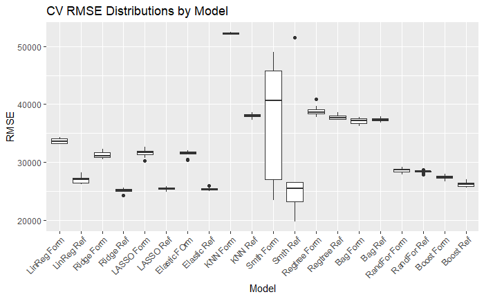

# Overview
This project is based on Kaggle's [House Prices - Advanced Regression Techniques](https://www.kaggle.com/competitions/house-prices-advanced-regression-techniques) competition. The objective is to predict the sale price of a house using its characteristics. Two datasets are provided, the training data and the testing data. Only the training data has the actual sale prices of the houses included. Models are created using the training data, and made to predict the prices of the houses in the testing data. The predicted prices are then submitted to Kaggle, which returns the root-mean-squared-logarithmic-error of the predictions. 

# Methods
The analysis was conducted in R. A transformed version of the training data was created, henceforth referred to as the refined data, featuring the removal of the variables 1stFlrSF, GarageArea, and TotRmsAbvGrd, removal of the house with index 1291, and the log-transformation of the response variable SalePrice and explanatory variables LotArea, OpenPorchSF, EnclosedPorch, and WoodDeckSF. The same transformations, excepting the removal of any houses, were also done to create a version of the testing data. These transformations were conducted to address multicollinearity, existence of nonlinear relationships between the response and predictors, and the presence of a high-leverage point. Root mean square error was used as the evaluation metric.  OLS regression, shrinkage, smoothing splines, KNN, and decision-tree based models were created, with their performance evaluated via cross-validation. 

# Results

Though smoothing splines on the refined data could outperform ridge regression on the refined data, it was deemed too unreliable, thus ridge regression was selected. It achieved a RMSLE of 0.1294 on Kaggle. 

While ridge regression on the refined data achieved the best cross-validation performance, 3 other models achieved similar results. All were built on the refined data. They were the LASSO, elastic net, and boosting models. Their predictions on the testing data were also submitted to Kaggle, achieving RMSLE's of 0.1291, 0.1289, and 0.1295 respectively. In addition, it can be seen that using the refined data greatly improved the performance of OLS regression and shrinkage models. This suggests two things. One, that the issues identified in the training data did exist and were corrected, to a degree. Two, that approaches that assume an underlying linear relationship between the response and explanatory variables, such as shrinkage models, can be just as viable as ones that do not through transformation of the data.
