# Executive Summary

This project is based on the [House Prices - Advanced Regression Techniques](https://www.kaggle.com/competitions/house-prices-advanced-regression-techniques) competition on Kaggle. The analysis was conducted entirely in R. OLS linear regression, shrinkage, KNN, smoothing splines, regression tree, bagging, random forest, and boosting models were evaluated. Using cross validation, their predictive performance was compared, with the best-performing model submitted to the competition. 

During the course of the analysis, two versions of the data were considered. The "formatted data", which makes no changes to the numeric variables, and the "refined data" which removed 3 numeric variables, log-transformed 4 numeric variables and the response variable, and removed a high-leverage point.

The models were evaluated on root mean square error. 4 models achieved similarly good cross-validation performance. All were trained on the refined data. They were a ridge regression model with tuning parameter $\lambda$ = 0.03; LASSO model with tuning parameter $\lambda$ = 0.0007; elastic net model with parameter values of $\alpha$ = 0.05 and $\lambda$ = 0.02; and a boosting model with tuning parameters $\eta$ = 0.1, $nrounds$ = 180, $max\_depth$ = 3, $colsample\_bytree$ = 0.25, $min\_child\_weight$ = 20, and $subsample$ = 0.25. The model with the best cross-validation performance was the ridge regression model, which achieved a root mean squared logarithmic error (RMSLE) of 0.1294 in the Kaggle competition. The LASSO, elastic net, and boosting models achieved RMSLE values of 0.1291, 0.1289, and 0.1295 respectively. From these results we can conclude that the refined data did improve the suitability of the data for linear models, and furthermore, that simpler, linear models can perform similarly to more complex and flexible models through transformation of the data.

# Introduction

Real-world datasets often present challenges that are less prominent in the simplified datasets commonly used for teaching statistical methods. Missing values, skewed distributions, multi-level categorical variables, and complex relationships between predictors can complicate both data preparation and statistical modeling. One such example is the Ames Housing dataset, which contains information on residential properties sold in Ames, Iowa, between 2008 and 2010. The dataset is used in Kaggle's [House Prices - Advanced Regression Techniques](https://www.kaggle.com/competitions/house-prices-advanced-regression-techniques) competition, where participants develop models to predict residential sale prices based on recorded property characteristics. This project aims to develop a predictive model for the competition. A variety of parametric and nonparametric models are fitted and evaluated using cross-validation, with the best-performing model selected for submission to Kaggle.

# Methodology

## Libraries

The following libraries were utilized for the statistical analyses and this report.

### Data Manipulation

[`dplyr`](https://cran.r-project.org/web/packages/dplyr/index.html) - Dataframe Reformatting

[`tidyr`](https://cran.r-project.org/web/packages/tidyr/index.html) - Dataframe Pivoting

[`stringr`](https://cran.r-project.org/web/packages/stringr/index.html) - String Manipulation

### Graphics

[`ggplot2`](https://cran.r-project.org/web/packages/ggplot2/index.html) - Graphing

[`ggcorrplot`](https://cran.r-project.org/web/packages/ggcorrplot/index.html) - ggplot2 Compatible Correlation Heatmap

[`gt`](https://cran.r-project.org/web/packages/gt/index.html) - Tables

### Models

[`caret`](https://cran.r-project.org/web/packages/caret/index.html) - Cross-Validation and Model-Building Framework

[`recipes`](https://cran.r-project.org/web/packages/recipes/index.html) - Data preparation 

[`leaps`](https://cran.r-project.org/web/packages/leaps/index.html) - Forward stepwise selection

[`glmnet`](https://cran.r-project.org/web/packages/glmnet/index.html) - Shrinkage Models

[`mgcv`](https://cran.r-project.org/web/packages/mgcv/index.html) - GAM Models (Smoothing Splines)

[`rpart`](https://cran.r-project.org/web/packages/rpart/index.html) - Regression Tree Models

[`ranger`](https://cran.r-project.org/web/packages/ranger/index.html) - Random Forest Models

[`xgboost`](https://cran.r-project.org/web/packages/xgboost/index.html) - Boosting Models

## Data

2 datasets are provided, the training data, which contains the actual sale price of the houses and their features, and the testing data, which only contains the features of the houses.

### Data Cleaning

There are over 1000 NAs in the training data. The vast majority of these are just placeholder values for if a house did not have a feature (eg. if a house has no basement, all basement related features are recorded as NA), per Kaggle in [data_description.txt](https://www.kaggle.com/competitions/house-prices-advanced-regression-techniques/data?select=data_description.txt). Others can be extrapolated to be similar (eg. an NA in the variable `GarageYrBlt` is most likely because a house doesn't have a garage). Once this is accounted for, only 1 NA was left with no easily attributed explanation, in the `Electrical` variable, which describes the electrical system in a house. This house was removed from the training data.

Similar NAs in the testing data were handled in the same manner. However, NAs in the single-digits exist in the variables `MSZoning`, `Exterior1st`, `Exterior2nd`, `KitchenQual`, `Functional`, and `SaleType` that were not recorded in data_description.txt. These were handled by assigning them to the most common non-NA level in the variable, as the inclusion of a handful of potentially erroneous recordings will not significantly affect that level's potential predictive power.

### Data Processing

#### Dummy Variables for Categorical Variables

Categorical variables in the training data had their levels transformed into dummy variables with one left out as a baseline, as is standard (eg. variable `LandSlope` has levels `Gtl`, `Mod`, and `Sev`. New variables `var_Gtl` and `var_Mod` are created, which are 1 if the house has a `Landslope` of `Gtl` or `Mod` respectively, and 0 otherwise. `Sev` is the baseline. If a house has a `Landslope` of `Sev`, both `var_Gtl` and `var_Mod` are 0.). This prevents linear dependence among the predictors.

The same was done to the testing data. The baseline variables in the testing data were the same as the baseline variables in the training data.

#### Sparse Categorical Levels

Categorical variables in the training data were individually analyzed to determine if any levels had less than 10 occurrences. Having too few occurrences would lead to absences of that level in some cross-validation folds, making their predictive power too unstable to estimate reliably. 10 was set as the minimum requirement as the vast majority of x-fold cross validation conducted was done using 10 folds, thus an ideal fold assignment would result in all folds having at least 1 occurrence of the level. These sparse levels were handled in the following manner in order of priority:

1. **Merge with Similar Level**: If a similar level exists in the variable, and their merger results in a level with at least 10 occurrences, the variables are merged (eg. `20` and `40` in `MSSubclass`, both are one-story houses, there are 532 `20` but only 4 `40`).

2.  **Merge into Other Level:** If there are no similar levels, but multiple levels with fewer than 10 occurrences that can be merged into a merger with at least 10 occurrences, then the levels are merged into an "Other" level (eg. `Blueste` and `NPkvill` in `Neighborhood` variable, `Blueste` has 2 occurrences and `Npkvill` has 9).

3.  **Merge into most Common Level:** If there are no similar levels, and the sum of occurrences of other levels with less than 10 occurrences is lower than 10, then the levels are merged into the existing level with most occurrences to produce the smallest affect on predictive power (eg. `Oth` and `WD` in `Contract` variable, only 3 `Oth` while 1261 `WD`).

The exact same changes made to the training data were made to the testing data, irregardless of if the level was sparse in the testing data (less than 10 occurrences) or not.

#### Merged Categorical Variables

There are 3 pairs of categorical variables that record features a house may have simultaneously: `Condition1` and `Condition2` (external features near house, eg. a railway), `Exterior1st` and `Exterior2nd` (material on outside of house), and `BsmtFinType1` and `BsmtFinType2` (quality of basement). These pairs all have the same levels. They were "merged", in that they were transformed into the same dummy variables (eg. if a house has `Artery` for either `Condition1` or `Condition2`, their dummy variable for `Artery` is 1). This was applied to both the training and testing data.

#### Formatted vs Refined Data

2 versions of the training data were created. The "formatted data", using only the alterations specified previously, and the "refined data". The refined data was created as an alternative dataset that better conformed to the assumptions of linear regression in the hopes that it may improve predictive accuracy for the models trained using it (it should be noted that just because a linear regression model, much less non-linear regression models, conforms better to the assumptions of linear regression does not necessarily mean it will have better predictive accuracy). 

The following transformations were made to the formatted data to create the refined data:

1. **Removal of Explanatory Variables 1stFlrSF, GarageArea, and TotRmsAbvGrd:** These variables had high correlation (> 0.8) with the variables `TotalBsmtSF`, `GarageCars`, and `GrLivArea` respectively. `TotalBsmtSF` appeared to have a slightly more linear relationship with `SalePrice` than `1stFlrSF.` `GarageCars` had a marginally better correlation with `SalePrice` than `GarageArea`, and `GrLivArea` had a noticeably better correlation with `SalePrice` than `TotRmsAbvGrd`.

2. **Removal of High-Leverage Point 1291:** The house in the training data with index 1291 was determined to be a high-leverage point and removed.

3. **Log-transformation of the response variable SalePrice:** The relationships between the response and the explanatory variables appeared slightly more linear following the log-transformation of `SalePrice`

4. **Log-transformation of the predictors LotArea, OpenPorchSF, EnclosedPorch, and WoodDeckSF:** The relationships between these predictors and $log(SalePrice)$ appeared more linear following their log-transformation. In addition, $log(LotArea)$, $log(OpenPorchSF)$, and $log(EnclosedPorch)$ saw increases in absolute value of correlation of 0.1429, 0.1419, and 0.0582 respectively.

Excepting the removal of any points, the same changes were made to the refined version of the testing data. Further details on these transformations and why they were conducted can be found in the "Diagnostics" sections of "Formatted Data" and "Refined Data", under "OLS Linear Regression with Subset Selection", in Methodology.

All models created on the refined data have their performance evaluated after their predictions have been transformed back onto the raw price scale. For models using `caret`, this was done with this custom summary function:

```{r, eval=FALSE}
f_raw_RMSE <- function(data, lev = NULL, model = NULL) {
  raw_obs <- exp(data$obs)
  raw_pred <- exp(data$pred)
  
  raw_rmse <- sqrt(mean((raw_obs - raw_pred)^2))
  
  return(c(raw_RMSE = raw_rmse))
}
```

Boosting models (xgboost) used this function:

```{r, eval=FALSE}
f_boost_raw_RMSE <- function(preds, dtrain) {
  actual_log <- getinfo(dtrain, 'label')

  actual_raw <- exp(actual_log)
  preds_raw  <- exp(preds)

  rmse <- sqrt(mean((actual_raw - preds_raw)^2))

  return(list(
    metric = 'raw_rmse',
    value = rmse
  ))
}
```

## Evaluation Metric

[Root mean square error](https://en.wikipedia.org/wiki/Root_mean_square_deviation) was used as the evaluation metric to determine model accuracy. RMSE is attractive since the house prices in the data can be extremely large ($755000 was the max in the training data). Taking the square root of the error reduces the penalty that non-square rooted metrics like [mean squared error](https://en.wikipedia.org/wiki/Mean_squared_error) or [mean absolute error](https://en.wikipedia.org/wiki/Mean_absolute_error) can overpenalize for. Additionally [Kaggle uses RMSE](https://www.kaggle.com/competitions/house-prices-advanced-regression-techniques/overview/evaluation) (though `SalePrice` is log-transformed) for its evaluation.

## OLS Linear Regression with Subset Selection

OLS linear regression is a popular model due to its simplicity and ease of interpretation.

Models follow this formula:

$\hat{y}_i = \hat\beta_0 + \hat\beta_1 x_{i1} + \hat\beta_2 x_{i2} + ... + \hat\beta_{p} x_{ip}$

Where:

* $x_{ip}$ corresponds to the value of the pth variable for the ith observation.

* $\hat\beta_0$ is the estimated y-intercept.

* $\hat\beta_p$, $p > 0$, is the estimated coefficient for the pth variable. It is the same for every ith observation.

* $\hat y_i$ is what the model predicts for the ith observation.

OLS linear regression aims to minimize $\sum (\hat y_i - y_i)^2$. Practically, it tries to "thread the middle of the data", predicting a mean value that neither overpredicts or underpredicts.

Subset selection is a way of tuning OLS linear regression models. Including every single predictor in a model can create a very large and complex model which is prone to overfitting, where the model performs superbly on the training data but has poor performance on the testing data due to over-reliance on quirks in the training data that may not be present in other datasets. Subset selection is a method of testing different combinations of predictors to determine which can be excluded, which keeps models simpler. Forward stepwise selection was utilized as the subset selection method, as best subset selection was too computationally impractical.

Under subset selection, the primary tuning parameter is $p$, the number of predictors the model is allowed to consider. The `leaps` package was utilized to conduct forward-stepwise selection, with `caret` facilitating cross validation.

It is doubtful that OLS linear regression will yield the highest-performing model. However it in and of itself is a good starting point to see how the data is structured, to assess multicollinearity and determine prospective data transformations.

### Formatted Data

#### Parameter Selection

5 iterations of 10-fold cross validation were conducted to determine reasonable values for the number of predictors $p$ to evaluate cross validation RMSE on.

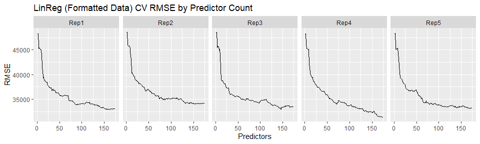

$p$ = 50, $p$ = 75, $p$ = 100, and $p$ = 150 were determined as plausible values for the optimal number of predictors. Those values, along with $p$ = 167, which is what `caret` determined to be the optimal number of predictors, had their CV RMSE determined and compared, using 10-fold cross validation with 10 repetitions each.

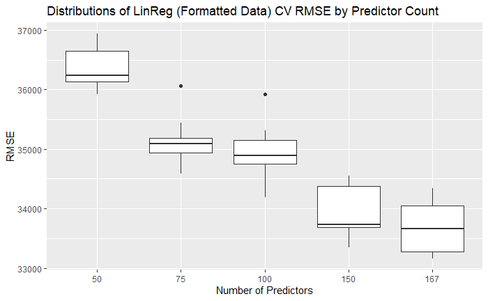

$p$ = 167 is clearly the best value for number of parameters for linear regression using the formatted data.

#### CV RMSE

The $p$ = 167 model produced a mean CV RMSE of 33672.32, median of	33661.26, standard deviation of	433.6525, and interquartile range of	770.8579.

#### Diagnostics

All diagnostics were conducted on a separately fit model, using the exact same predictors (but not necessarily the same coefficients) used by the $p$ = 167 model.

##### Diagnostic Plots

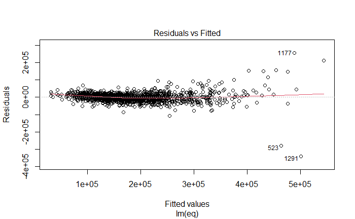

The residuals form a slight curve, with it getting worse at higher values of SalePrice. The curve is slight enough though that heteroskedasticity should not be a major issue. It also suggests that the relationship between the response and the predictors is largely linear.

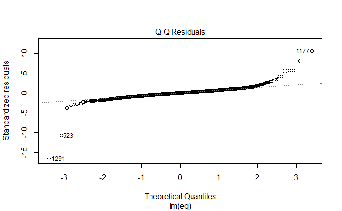

The QQ plot shows that the vast majority of the residuals conform to a normal distribution, though this breaks down at extremely large and extremely small predictions. There does not appear to be any major issues in regards to normality of the errors.

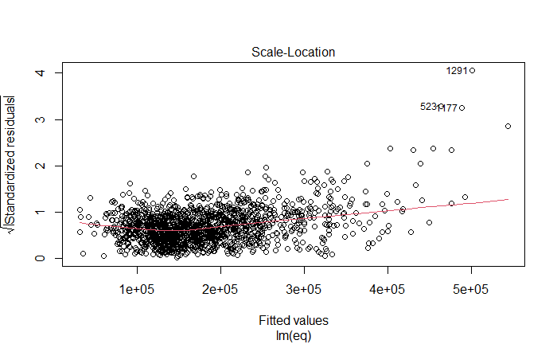

In the scale-location plot we see a slight curve in the body of the residuals at larger predictions, but the bulk of them conform along a largely straight line. Heteroskedasticity shouldn't be a major issue.

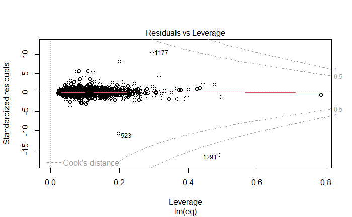

Only one high-leverage point exists in the training data, the house with index of 1291.

##### Muticollinearity Analysis

The correlation between every pair of predictors in the data was computed.

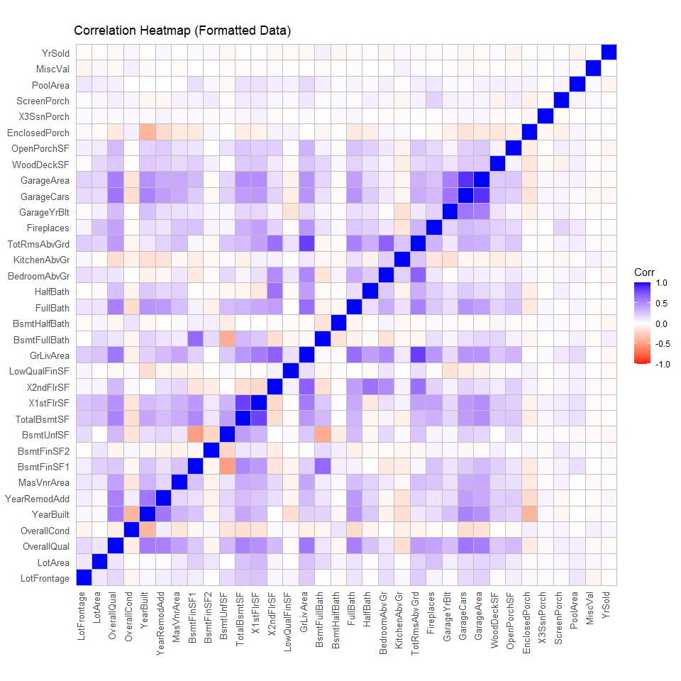

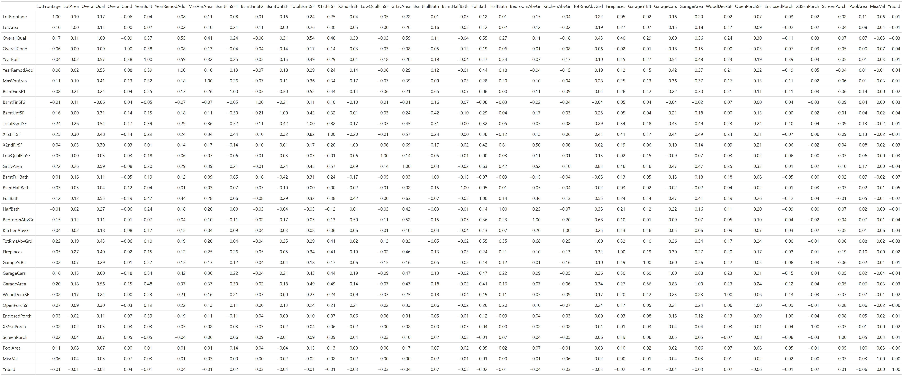

There are only 3 predictor pairs with a correlation with an absolute value higher than 0.8, `1stFlrSF` and `TotalBsmtSF`, `GarageArea` and `GarageCars`, and `TotRmsAbvGrd` and `GrLivArea`. The next highest pair was `2ndFlrSF` and `GrLivArea`, at 0.69. Breaking up the pairs with a correlation greater than 0.8 should resolve most issues due to multicollinearity faced by the model.

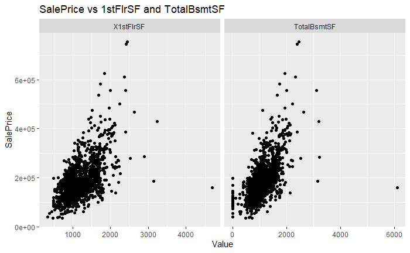

The differences in correlation with `SalePrice` between `1stFlrSF` and `TotalBsmtSF` were marginal, at 0.607 and 0.6133 respectively. However, `TotalBsmtSF` appears to have a more linear relationship with `SalePrice`, and was retained for that reason.

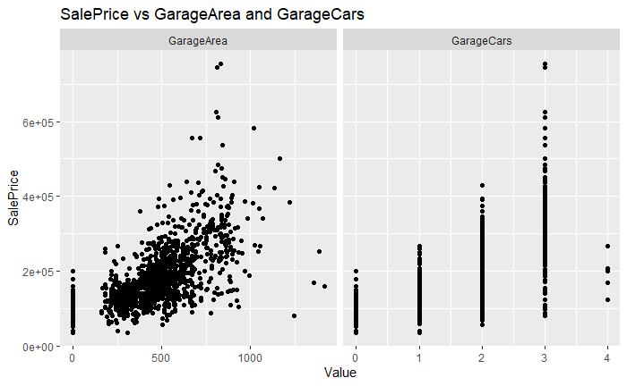

Both `GarageArea` and `GarageCars` show a "fanning out" with `SalePrice` as they increase in value, making neither relationship especially linear. Differences in correlation with `SalePrice` between `GarageArea` and `GarageCars` were also marginal, at 0.6225 and 0.6397 respectively. `GarageCars` was retained, as its fanning out behavior appears less severe than that of `GarageArea`.

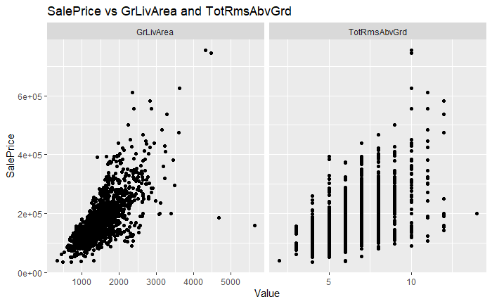

`GrLivArea` has a much higher correlation with `SalePrice` than `TotRmsAbvGrd`, 0.7101 vs 0.5364, which is why it was retained.

##### Quantitative Variable Transformations

The response variable `SalePrice` was log-transformed to see if its relationship with the quantitative predictors would be more linear.

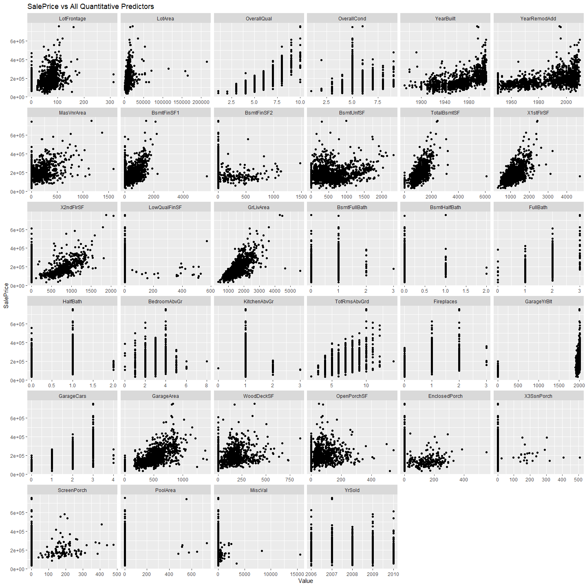

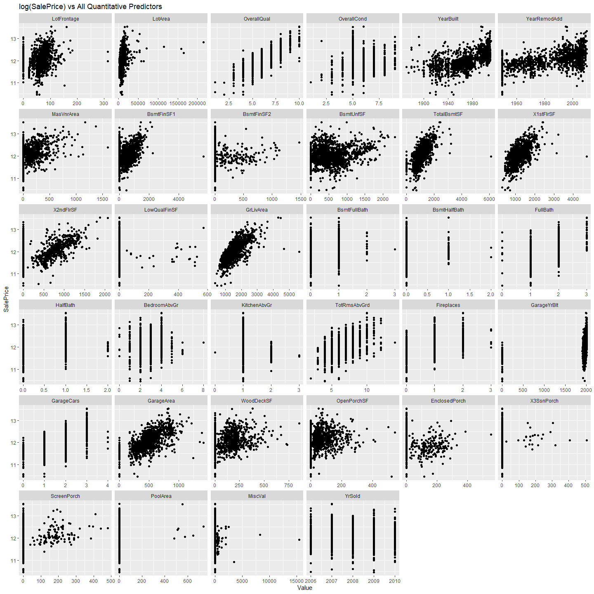

Following a log-transformation of `SalePrice`, many of the relationships between `SalePrice` and the predictors look more linear, with less spreading out and reduced similarity to an exponential relationship.

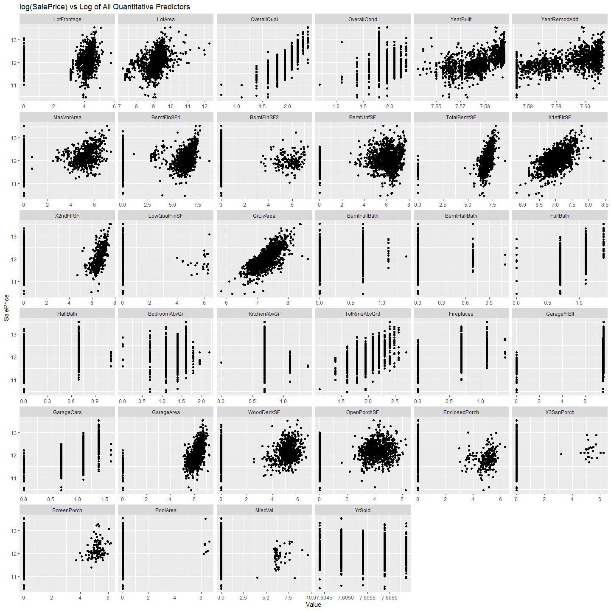

Following a log-transformation of the predictors, both `LotArea` and `EnclosedPorch` saw noticeable increases in correlation with $log(SalePrice)$, from 0.2577 to 0.4006, and from -0.1495 to -0.2078 respectively. Additionally, `WoodDecSF` appears to have a more linear relationship with $log(SalePrice)$ following its log-transformation. The other explanatory variables experienced more marginal changes.

### Refined Data

#### Parameter Selection

5 iterations of 10-fold cross validation were conducted to determine reasonable values for the number of parameters $p$ to evaluate cross validation RMSE on.

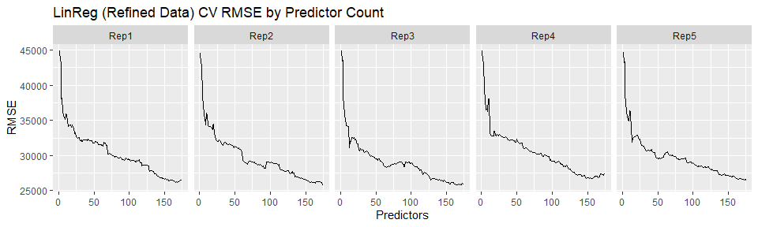

$p$ = 75, $p$ = 100, and $p$ = 150 were determined as plausible values for the optimal number of predictors. `caret` determined $p$ = 165 to be the optimal number of predictors. 

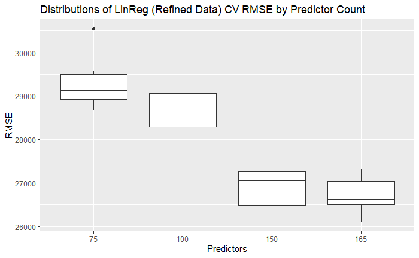

From the graph, $p$ = 165 was determined to be the best parameter value. While $p$ = 150 had similar accuracy while producing a simpler model, its high variability makes it less attractive.

#### CV RMSE

The $p$ = 165 model's 10 iterations' RMSE's had a mean of 26698.83, median of	26618.80, standard deviation of	417.2858, and IQR of	539.3335.

#### Diagnostics

Diagnostics were conducted on a new model, using the refined data, fit with $p$ = 175 predictors.

##### Diagnostic Plots

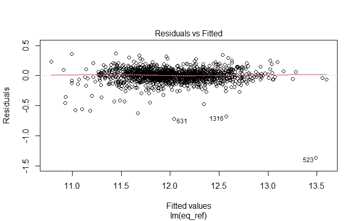

In the residuals vs fitted plot for the refined data, the residuals overall form a more straight cloud, indicating a slightly more linear relationship between the response and the predictors. Again, heteroskedasticity does not seem to be a major issue, as indicated by the graph.

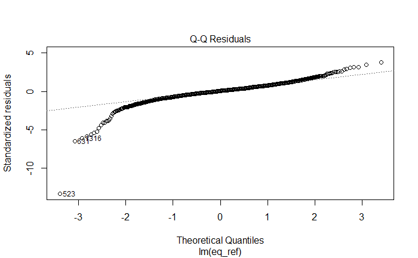

Like the diagnostic qq plot for the $p$ = 167 model on the formatted data, residuals are largely normally distributed except for those for the predictions that were on the extremes. Non-normality of errors should not be a major issue.

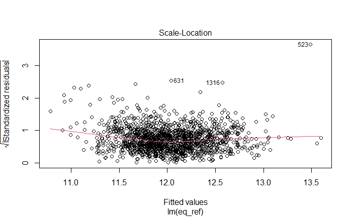

From the scale-location plot of the $p$ = 175 model on the refined data, the bend that was observed in the one of the $p$ = 167 model is less pronounced. Heteroskedasticity is less of an issue with the model on the refined data.

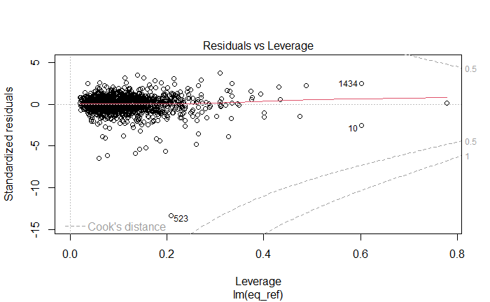

From the residuals vs leverage plot, we can see that with adjustments made to the refined data (notably the removal of the house with index 1291), there are no high-leverage points left in the data.

##### Multicollinearity Analysis

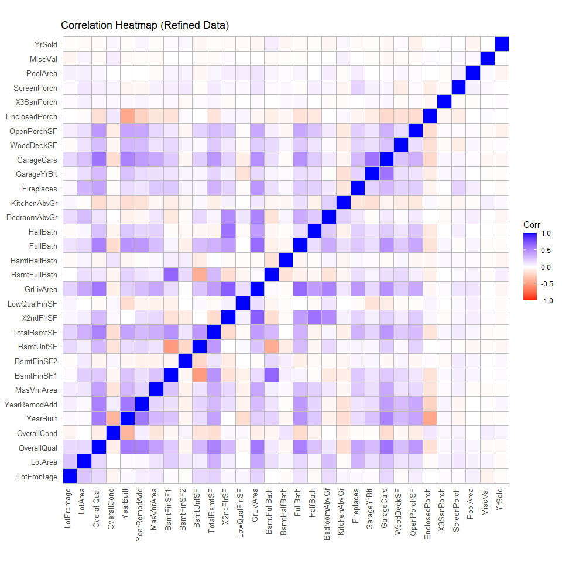


The highest correlation between two variables is around 0.7, between `GrLivArea` and `2ndFlrSF`. Compared to the formatted data, which had correlation values between predictors with absolute value greater than 0.8, the refined data has less issues with multicollinearity.

## Shrinkage

Shrinkage models are a type of linear regression model. Unlike in OLS linear regression, where subset selection is often used to outright include or exclude predictors from the model, in shrinkage, the value of the coefficients are reduced, some to near 0 (or exacly 0 in LASSO's case).

A tuning parameter $\lambda$ is used to reduce the value of the predictors' coefficients, with higher values of $\lambda$ decreasing the predictors more aggressively. The `glmnet` package provided all shrinkage models, with `caret` facilitating cross validation.

Shrinkage models can have improved performance over OLS linear regression models due to having lower variance. By reducing the values of the predictors' coefficients, the variability of the model decreases as there is less room for the coefficients of the predictors to fluctuate, though this does also increase bias. For data with many predictors and interactions between them like Ames, this tradeoff can be worth it and result in much less variability while only slightly increasing in bias.

### Ridge Regression

Ridge regression is a typical shrinkage model.

#### Formatted Data

##### Parameter Selection

10 iterations of 10-fold cross validation via `caret` were conducted to determine the optimal value for the parameter $\lambda$.

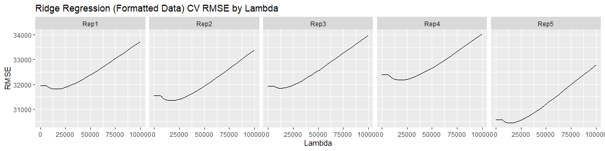

`caret` determined the best $\lambda$ value to be 15556.76. 15000 was selected as a reasonable value for the optimal $\lambda$ value.

##### CV RMSE

10 iterations of 10-fold cross validation were conducted at $\lambda$ = 15000. The 10 CV RMSE values had a mean of 31261.28, median of 31103.41, standard deviation of 558.9165, IQR of	810.1399	

#### Refined Data

##### Parameter Selection

10 iterations of 10-fold cross validation via `caret` were conducted to determine the optimal value for the parameter $\lambda$.

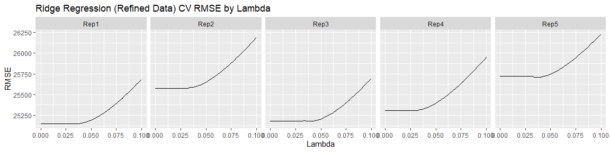

`caret` determined the best $\lambda$ value to be 0.0313. From the graphs any $\lambda$ value below around 0.03 would minimize RMSE. $\lambda$ = 0.03 was selected as the optimal value.

##### CV RMSE

10 iterations of 10-fold cross validation were conducted at $\lambda$ = 0.03. The 10 iterations produced a mean CV RMSE of 25122.28, median of 25165.98, standard deviation of 350.466, and IQR of 298.2073.	

### LASSO

LASSO is a shrinkage model that fully zeroes out some coefficients, whereas ridge regression only decreases them to near 0. In doing so, LASSO produces simpler models than ridge, but those models are not inherently better at prediction.

#### Formatted Data

##### Parameter Selection

10 iterations of 10-fold cross validation via `caret` were conducted to determine the optimal value for the parameter $\lambda$.

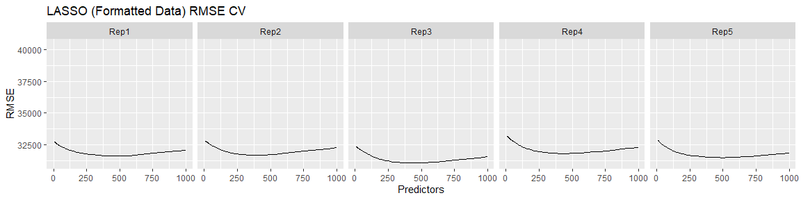

`caret` determined the optimal $\lambda$ value to be 464.1589. $\lambda$ = 450 was selected as a reasonable value for $\lambda$.

##### CV RMSE

10 iterations of 10-fold cross validation were conducted at $\lambda$ = 450. The 10 CV RMSE values had a mean of 31568.05, median of	31635.74, standard deviation of	704.5991, and IQR of	604.5236.

#### Refined Data

##### Parameter Selection

10 iterations of 10-fold cross validation via `caret` were conducted to determine the optimal value for the parameter $\lambda$.

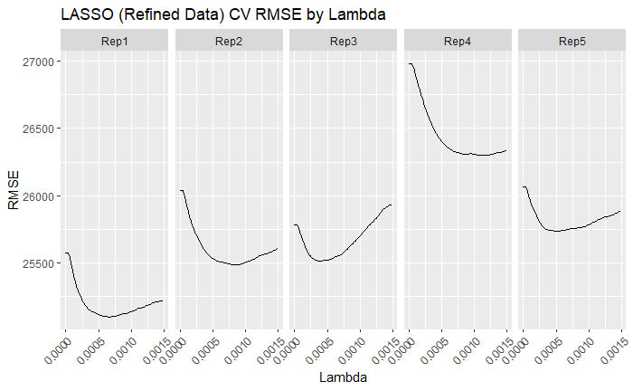

`caret` determined the optimal $\lambda$ value to be 0.0007. From the graphs, 0.0007 is a reasonable value for the optimal $\lambda$ value.

##### CV RMSE

10 iterations of 10-fold cross validation were conducted at $\lambda$ = 0.0005. The 10 iterations' CV RMSE's had a mean of 25447.66, median of	25450.37, standard deviation of	317.5768, and IQR of	331.2827.

### Elastic Net

Elastic net is a compromise between ridge regression and LASSO. Both ridge and LASSO penalties are used, with their relative weights controlled by the tuning parameter $\alpha$. $\alpha$ values closer to 0 give more weight to the ridge penalty and produce models more similar to ridge regression, while an $\alpha$ closer to 1 gives more weight to the LASSO penalty and produces a model more similar to LASSO.

#### Formatted Data

##### Parameter Selection

5 iterations of 10-fold cross validation via `caret` were conducted to determine the optimal values for the parameters $\alpha$ and $\lambda$.

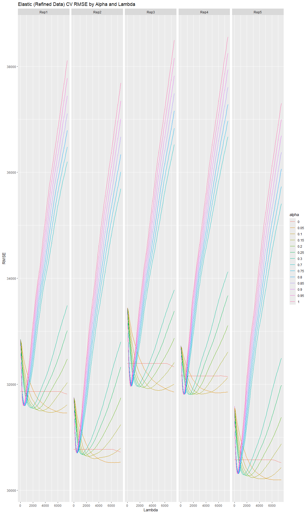

`caret` determined $\alpha$ = 0.05, $\lambda$ = 7295.918 to be optimal. $\alpha$ = 0.05, $\lambda$ = 7000 were selected as reasonable values for the optimal parameter values.

##### CV RMSE 

10 iterations of 10-fold cross validation were conducted for a elastic net model with $\alpha$ = 0.05, $\lambda$ = 7000. These 10 models produced a mean CV RMSE of 31458.95, median of	31627.76, standard deviation of	589.9282, and IQR Of 375.2135.

#### Refined Data

##### Parameter Selection

5 iterations of 10-fold cross validation via `caret` were conducted to determine the optimal values for the parameters $\alpha$ and $\lambda$.

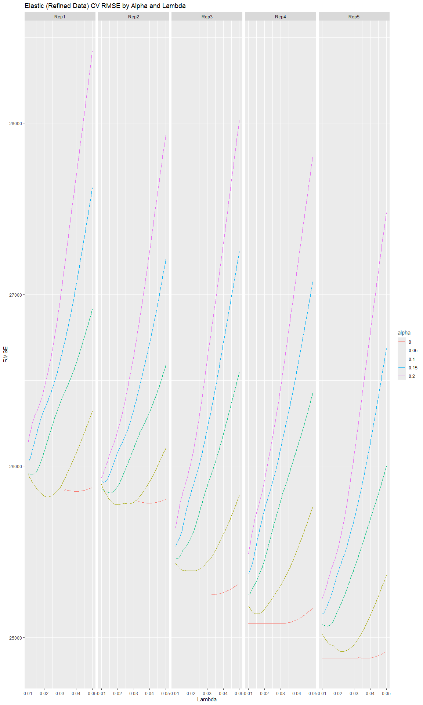

`caret` determined $\alpha$ = 0, $\lambda$ = 0.0318 to be optimal. Though $\alpha$ = 0 outperformed the other values, since $\alpha$ = 0 is equivalent to ridge regression it was deemed redundant, and thus the next best value $\alpha$ = 0.05 was selected. $\lambda$ = 0.02 was determined to be a reasonable $\lambda$ value for $\alpha$ = 0.05

##### CV RMSE

10 iterations of 10-fold cross validation were conducted, resulting in a mean CV RSME of 25358.41, median of	25305.87, standard deviation of	271.2039, and median of	265.1881.

## Smoothing Splines

Smoothing splines are part of a family of models called "generalized additive models". These models are similar in structure to linear regression but use functions of the predictor values instead of coefficients, which allows the effect of a predictor to change as the predictor's value changes (linear regression is a special case of a generalized additive model where the function results in a constant value for all values of the predictor).

Smoothing splines specifically fit smoothing functions to the predictors. These functions reduce the "jumpiness" of the model, preventing it from reacting too strongly to variations in the training data. The effect on predictive performance is similar to shrinkage models, where an increase in bias can lead to a larger decrease in variance, potentially increasing predictive accuracy.

Smoothing splines were provided by the `mgcv` package. The `mgcv` package automatically determines the amount a predictor should be smoothed. The tuning parameter then is the variables/number of variables to include in the model. For computational feasibility, the same variables used by the final linear regression models were used by the smoothing spline models. For the smoothing spline model on the formatted data, the variables used by the p = 167 OLS linear regression model on the formatted data was used. Likewise, for the smoothing spline model on the refined data, the same predictors used by the p = 165 OLS linear regression model on the refined data was used.

Not all numeric variables were smoothed. There is no reason to smooth a predictor with few unique levels, as the presence of a complicated nonlinear relationship being present between said predictor and the response is low. Any numeric predictor with fewer than 30 unique levels was not smoothed. This was done to both the model on the formatted and the refined data.

Cross validation was conducted using base R due to technical issues with integrating `mgcv` smoothing splines into `caret`. 

### Formatted Data

#### CV RMSE

For computational reasons, only 5 iterations of 5-fold cross validation were conducted. This resulted in a CV RMSE mean of 37184.2, median of 40638.51, standard deviation of 11359.29, and IQR of 18690.77.

### Refined Data

#### CV RMSE

For computational reasons, only 5 iterations of 5-fold cross validation were conducted. This resulted in a CV RMSE mean of 29301.13, median of 25419.83, standard deviation of 12726.55, and IQR of 3419.132.	

## KNN

K-nearest neighbors (KNN) models use the points closest to a new observation (in terms of their predictor values) to predict the response for a new observation. Its tuning parameter is $k$, which determines the number of neighboring observations used to make a prediction. In a regression context, a KNN model takes the $k$ closest points (in terms of their predictor values) to an observation, and uses the mean of their response values as the prediction.

Notably, KNN is non-parametric and does not assume that there is a linear relationship between the predictors and SalePrice, unlike the previous models. This can result in improved predictive accuracy, if the underlying relationship between the response and explanatory variables in the data is indeed non-linear.

Both the formatted and refined data had their numeric predictors normalized. Differences in scale can give some predictors outsized influence over others (a variable ranging from 1-10 will always be "closer" than a variable ranging from 0-100000). Normalizing them places them on the same standard-normal scale and prevents this.

`caret` was used for both the KNN model and cross validation.

### Formatted Data

#### Parameter Selection

5 iterations (due to computational limitations) of 10-fold cross validation were conducted to determine the optimal value for the parameter $k$.

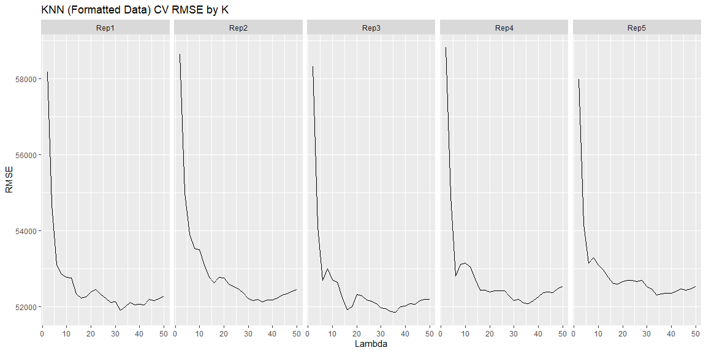

`caret` determined $k$ = 34 to be optimal, which seems reasonable.

#### CV RMSE

10 iterations of 10-fold cross validation were conducted resulting in a mean CV RMSE of 52229.78, median of 52216.34, standard deviation of 164.1117, and IQR of 247.0885.

### Refined Data

#### Parameter Selection

5 iterations (due to computational limitations) of 10-fold cross validation were conducted to determine the optimal value for the parameter $k$.

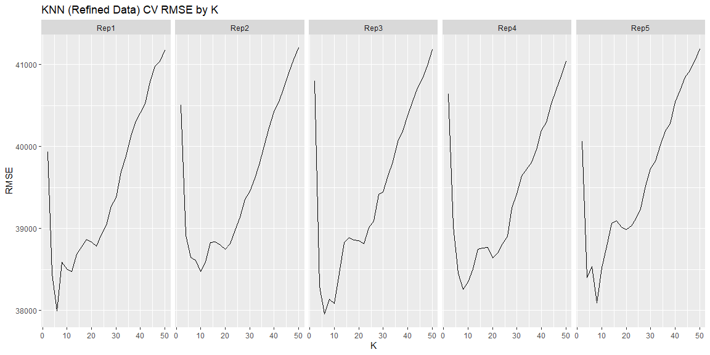

`caret` determined 6 to be the optimal value. It appears that the minimum for RMSE varied between 6-10 across the 5 iterations, making 8 a reasonable middle ground.

#### CV RMSE

10 iterations of 10-fold cross validation were conducted resulting in a mean CV RMSE of 38055.57, median of 38072.27, standard deviation of 425.6488, and IQR of 400.9322.

## Decision Tree-Based Models

Decision trees are a class of models that function somewhat like a "Choose Your Own Adventure" story. There are a series of nodes, each with a question and two branching paths. Depending on an observation's predictor values, it is sent down one of these paths until it reaches a terminal node, where the model makes a prediction.

All models in this category are non-parametric, and thus can offer improved predictive accuracy if the underlying relationship between the response and explanatory variables in the data is indeed non-linear.

### Regression Tree

Regression trees are basic decision tree models applied to regression. 

The regression trees from the `rpart` package were utilized, with `caret` facilitating cross validation. While there are normally multiple tuning parameters for decision trees, `caret` only uses $cp$, the complexity parameter. Higher values of $cp$ result in simpler trees with fewer branches and terminal nodes, while lower values allow more complex trees to be constructed.

#### Formatted Data

##### Parameter Selection

5 iterations of 10-fold cross validation were conducted to determine the optimal $cp$ value.

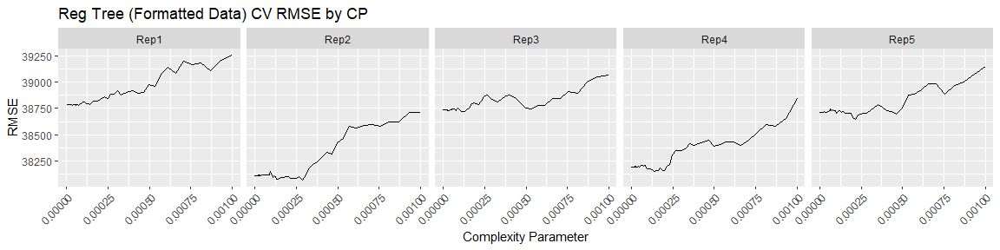

`caret` determined 0.00013 to be optimal, which seems reasonable.

##### CV RMSE

10 iterations of 10-fold cross validation were conducted, yielding a CV RMSE mean of 38857.8, median of 38616.03, standard deviation of 874.9688, and IQR of 653.133.

#### Refined Data

##### Parameter Selection

5 iterations of 10-fold cross validation were conducted to determine the optimal $cp$ value.

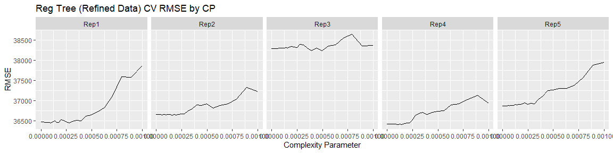

$cp$ = 0.0001 was determined to be a reasonable value for the ideal $cp$ value.

##### CV RMSE

10 iterations of 10-fold cross validation were conducted producing a CV RMSE mean of 37752.52, median of 37653.26, standard deviation of 415.5736, and IQR of 514.9112.

### Bagging

Bagging is a type of model that uses multiple decision trees. Each tree is trained on its own bootstrapped sample of the training data. Given a new observation, the model uses the aggregate predictions of each tree (in a regression context, the average of all the trees' predictions is taken) as its prediction. Bagging's main advantage is that it reduces model variance. The aggregate of many trees is much more stable than a single tree thanks to redundancy.

`caret` provided both the bagging model and the means for cross validation. The bagging method provided by `caret` automatically tunes the model and does away with the need for parameter selection, which would otherwise call for things such as the number of trees created and the size of each bootstrap sample, among other things.

#### Formatted Data

##### CV RMSE

10 iterations of 10-fold cross validation yielded a CV RMSE mean of 37152.25, median of 37227.87, standard deviation of 517.8218, and IQR of 799.3616.

#### Refined Data

##### CV RMSE

10 iterations of 10-fold cross validation produced a CV RMSE mean of 37339.46, median of 37278.51, standard deviation of 341.6374, and IQR of 431.4771.	

### Random Forest

Random forest, like bagging, also uses multiple decision trees. During the creation of each node for the trees, only a few randomly selected predictors are allowed to be used by the model. This makes the trees more different from each other, as bagging can produce very similar trees if some predictors are sufficiently dominant. This can reduce the variance of the model by decorrelating the trees, making the model overall less susceptible to quirks in the data than it otherwise would be if the trees were more similar to each other.

The random forest model was provided by `ranger`. `caret` was used to conduct cross validation. When used in conjunction with `caret` the only relevant tuning parameter is $mtry$, which is the number of predictors that are randomly selected to be considered by the model at each node split.

#### Formatted Data

##### Parameter Selection

10-fold cross validation (no repetitions due to computational limitations) was utilized to determine the optimal value of $mtry$.

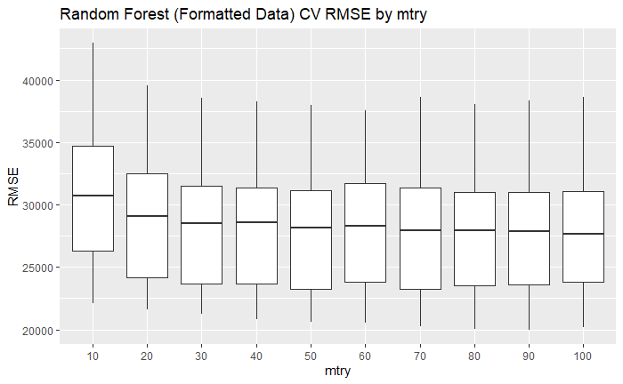

Past an $mtry$ value of 30 changes in CV RMSE are negligible. 30 seems to be a reasonable value.

##### CV RMSE

10 iterations of 10-fold cross validation were conducted, producing a CV RMSE mean of 28582.05, median of 28667.32, standard deviation of 379.1819, and IQR of 412.1993.	

#### Refined Data

##### Parameter Selection

10-fold cross validation (no repetitions due to computational limitations) was utilized to determine the optimal value of $mtry$.

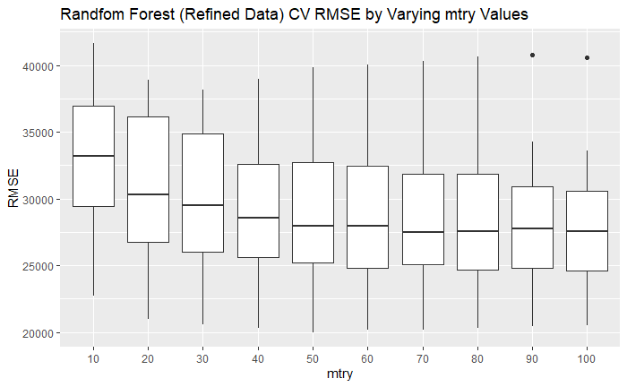

$mtry$ values of 90 and 100 were the best. Proceed with 90 as it is slightly less computationally expensive than 100.

##### CV RMSE

10 iterations of 10-fold cross validation produced a CV RMSE mean of 28373.22, median of 28434.11, standard deviation of 245.2401, and IQR of 80.98764.

### Boosting

Boosting uses multiple decision trees, with each tree built one after the other with a focus on correcting the mistakes of the previous tree. The final prediction is the aggregated prediction of all the trees. Boosting models have reduced model bias due to their iterative nature.

`xgboost` provided the boosting model. Its model specifically is an extreme gradient boosting model, which is an optimized version of gradient boosting. Gradient boosting uses pseudo-residuals (derived from a loss function) rather than the actual residuals to assess how mistaken the previous tree was. Cross validation was conducted using base R.

#### Tuning Parameters

Of the tuning parameters relevant to `xgboost`, only 4 were analyzed in-depth:

1. **$max\_depth$**: This controls how complex the individual trees are allowed to be.

2. **$subsamples$**: This controls what proportion of the total training data the model allows each tree to use.

3. **$colsample\_bytree$**: This controls what proportion of the predictors in the training data the model allows each tree to use.

4. **$min\_child\_weight$**: This controls how many observations are needed for the model to continue creating child nodes.

For both models trained on the formatted and the refined data:

$max\_depth$ was varied between values {3, 4, 5}, $subsamples$ and $colsample\_bytree$ between values {0.25, 0.5, 0.75, 1}, and $min\_child\_weight$ between values {5, 10, 20}.

The rest were kept constant:

1. **$\eta$**: This controls how much of an effect each successive tree has on the model's prediction.

2. **$nrounds$**: This controls how many successive trees are created.

$\eta$ was kept at 0.1 for both models created on the formatted and the refined data. $nrounds$ wasn't cross-validated for as `xgboost` will automatically determine and use the optimal number of trees it finds.

#### Formatted Data

##### Parameter Selection

10-fold cross validation was conducted for each combination of tuning parameter that was assessed (no repitions due to computational limitations).

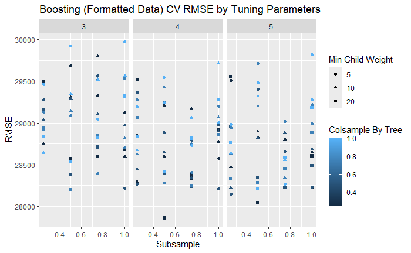

$max\_depth$ value of 4, $min\_child\_weight$ value of 20, $subsample$ value of 0.5, and $colsample\_bytree$ value of 0.25 performed the best, and seem reasonable as the optimal parameter values.

##### CV RMSE

10 iterations of 10-fold cross validation produced a CV RMSE mean of 27398.07, median of 27408.34, standard deviation of 416.7343, and IQR of 443.1214.

#### Refined Data

##### Parameter Selection

10-fold cross validation was conducted for each combination of tuning parameter that was assessed (no repitions due to computational limitations).

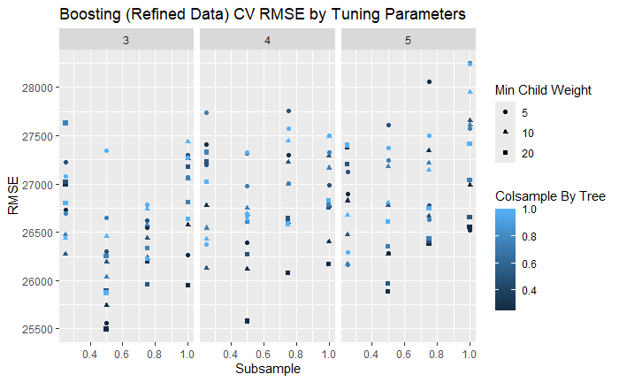

$max\_depth$ value of 3, $colsample\_bytree$ value of 0.25, $min\_child\_weight$ value of 20, and $subsample$ value of 0.25 performed the best and is reasonable for the optimal parameter values.

##### CV RMSE

10 iterations of 10-fold cross validation yielded a CV RMSE mean of 26234.02, median of 26255.82, standard deviation of 494.6848, and IQR of 579.0663.

# Results

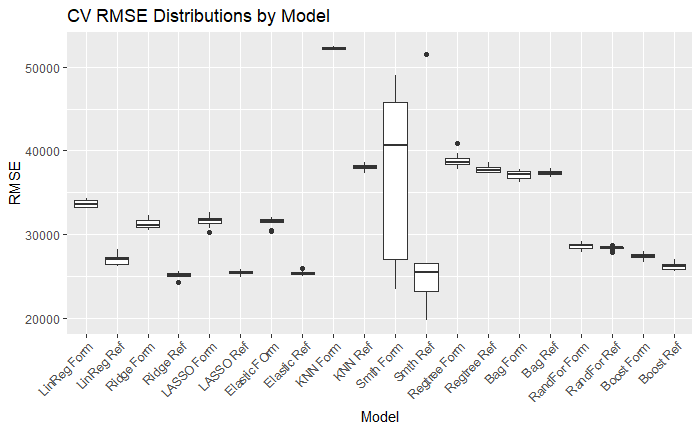

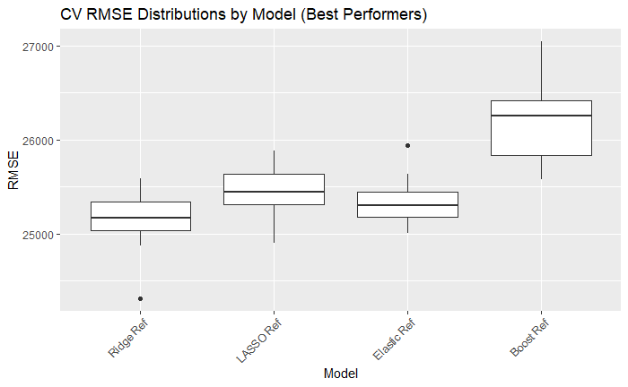

Of the models created, the ridge regression, LASSO, elastic net, and boosting models on the refined data were the best. Though the smoothing model using the refined data could achieve better results, its variability, notably the possibility of it "critically failing" as evidenced by its extreme upper outlier, makes it less desirable.

The ridge regression model on the refined data was selected as the best performing model, and its predictive results were submitted to the Kaggle competition, resulting in a score of 0.1294.

# Discussion

## Comparison of Best-Performing Models and Interpretation

The LASSO, elastic net, and boosting models on the refined data also had their predictions submitted to the Kaggle competition. In order to fit a boosting model that can be used for prediction, $nrounds$ needed to be determined. This was done via cross validation, with $nrounds$ = 180 determined to be a reasonable parameter value. This resulted in scores of 0.1291, 0.1289, and 0.1295 respectively. 

These results all indicate similar performance between the 4 best models. Most interestingly, the boosting model performed very similarly to the shrinkage models, despite being entirely different in concept, with the shrinkage models being parametric and assuming a fundamentally linear relationship between `SalePrice` and the predictors, while boosting is non-parametric and does not make such an assumption. What's more, boosting on the formatted data performed far better than the shrinkage models on the formatted data. This suggests that the alterations made in the creation of the refined data largely accomplished its goal of improving the data from a modeling perspective. Furthermore, it indicates that while more flexible models (such as boosting) are better at handling the raw data, simpler models can achieve similar performance through transformation of the data.

## Limitations

The findings of this report are limited by computational limitations. Not all models received the same amount of cross validation folds and rounds, due to being too expensive computationally. This issue was most notable for the smoothing and boosting models. While most models received 10 rounds of 10-fold cross validation, smoothing and boosting received only 5 rounds of 5-fold cross validation and 1 round of 10-fold cross validation respectively. These differences may have contributed to these models producing less attractive (less consistent) cross validation results. Additionally, the parameters governing boosting's learning rate ($\eta$) and number of trees ($nrounds$) was not cross-validated for simultaneously with $max\_depth$, $subsample$, $colsampe\_bytree$, and $min\_child\_weight$, meaning it is possible that the optimal combination of parameters was missed by cross validation. Boosting may be outright better than the shrinkage models on the refined data with the optimal parameter combination.